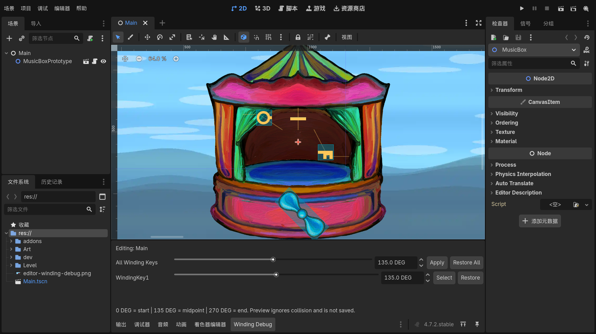

# Winding Debug in the Editor

Open a scene in Godot's **2D editor** and click the **Winding Debug** bottom tab.
The game does not need to be running. This editor plugin replaces the former
runtime debug overlay.

The plugin is enabled in this project. If the tab is missing, enable
**Winding Debug** in **Project > Project Settings > Plugins**. Reopen a closed
dock from **Editor > Editor Docks > Winding Debug**.

## Set an angle

- Use **All Winding Keys** to preview every controller in the edited scene,
  including controllers inside scene instances. Change its slider or number.
  **Apply** reapplies the current value.
- Use a named controller's row to preview just that key and its bound objects.
  **Select** selects the controller in the Scene tree and Inspector. Hover its
  name to see its node path.
- Values are limited to **0..270 degrees**, with decimal entry supported.
  **0 degrees is the path start, 135 is halfway, and 270 is the path end.**
- Each change immediately updates the visible winding key and the positions of
  all movable objects assigned to that controller through **Winding Key**.
- **Mixed** means the controllers have different preview values. A scene with no
  controllers shows a hint to open a scene with winding-key controllers.



## Edit and restore

Preview uses absolute path positions and **ignores collision** so that you can
check alignment behind barriers. Gameplay still uses collision sweeps.

You can edit line points, move a path, or rotate and scale it while the preview
is active. **Path Rotations** in the selected movable's Inspector sets its angle
at each point; **Edit Path Rotation** in the 2D toolbar provides orange drag
handles. The body follows the edited position and angle at the selected fraction. The
normal point-zero preview returns when you restore the group.

- **Restore** clears the preview for one winding key and its objects.
- **Restore All** clears every preview in the edited scene.
- Switching scenes, closing the dock, disabling the plugin, or starting the game
  also clears the preview.

Preview angles and poses are temporary. Saving a scene writes the authored
transforms, then reapplies the preview in the editor. Path edits and other
intentional scene edits still save normally. There is no runtime debug autoload
or F3 panel.

## Integration

The editor plugin lives in `res://addons/winding_debug/`. It discovers
`WindingObjectController` nodes in the edited scene without runtime groups or
manual registration. `MovableObject2D` uses its existing **Winding Key** field.
The music-box timeline uses **Object Controller** to identify its visible key.

The plugin calls editor-only preview methods on the movable and the winder.
These methods do not advance the gameplay clock or run audio. The plugin
restores all previews before the editor starts the game.

## Validation

From the project directory:

```powershell
.\dev\global_debug\validate_editor_debug.ps1
.\dev\global_debug\validate_editor_debug.ps1 -Capture
& "..\Godot_v4.7.2-stable_win64.exe" --headless --path . --fixed-fps 60 --script res://dev/movable_object_test/run_movable_object_tests.gd
```

The editor validation runs **40 checks** inside an actual Godot editor without
starting the game. It tests global and per-key controls, clamping, immediate
positions and rotation, live path edits, separate groups, collision bypass,
scene switching, plugin disabling, pre-play restoration, and saving scenes
without preview transforms. Point rotation checks also cover handles, undo,
redo, cancellation, new point fields, and persistence on scene instances.
It uses a disposable project copy under
`.godot/editor_winding_validation/` to leave the source scenes untouched.

`-Capture` runs **44 checks**, including mouse dragging with Shift snapping in
the actual panned and zoomed editor viewport. It writes debug and point-rotation
screenshots in that copy. The separate gameplay runner verifies **68 checks**
for winding input, proportional movement, rotation, collisions, and return behavior.

Engine references: [EditorDock](https://docs.godotengine.org/en/stable/classes/class_editordock.html),
[running code in the editor](https://docs.godotengine.org/en/stable/tutorials/plugins/running_code_in_the_editor.html),
and [Node save notifications](https://docs.godotengine.org/en/stable/classes/class_node.html#class-node-constant-notification-editor-pre-save).
