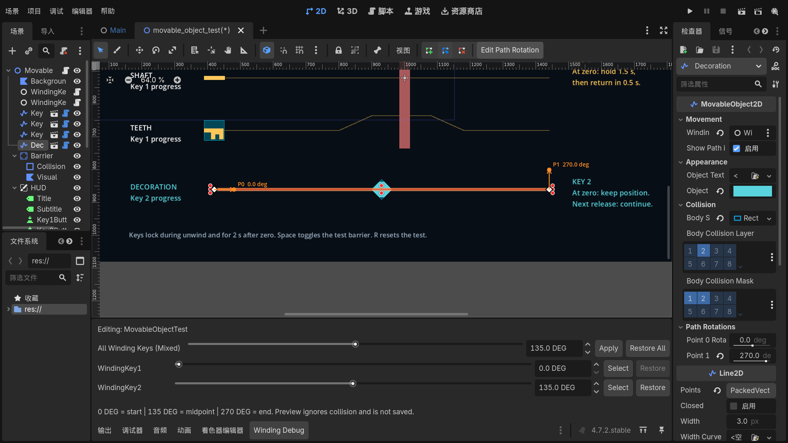
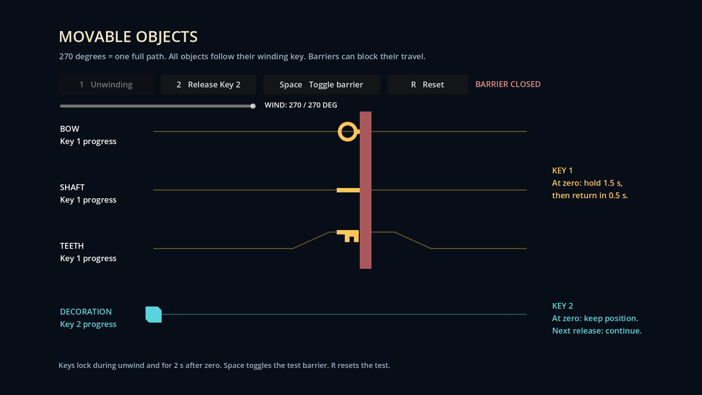
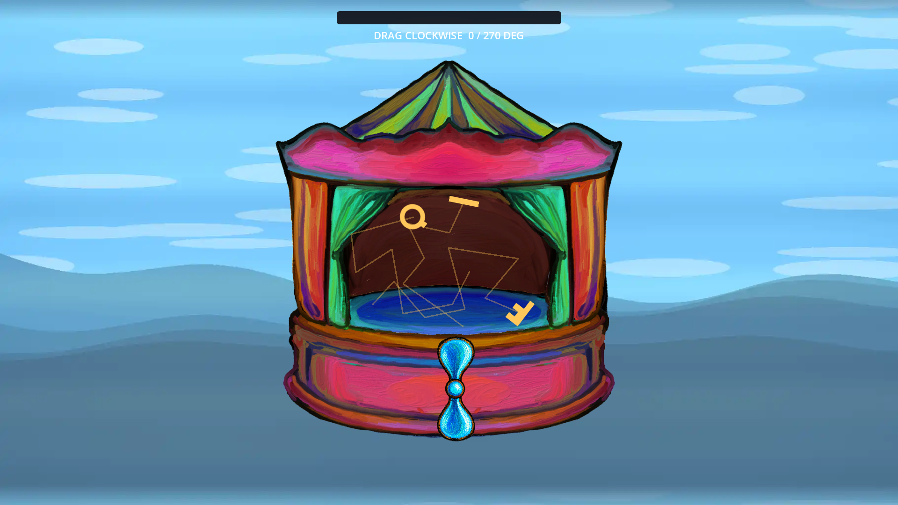

# Winding Keys and Movable Objects

Use `res://Level/objects/movable_object.tscn` for key fragments, decorations, or
functional objects. Its `Line2D` root defines the path. Its solid `Body` child
moves along the line as the assigned winding key unwinds.

## Play with the winding key

Run **F5**. Hold the left mouse button on the winding key and drag around its
center. Drag clockwise to wind it and counterclockwise to reduce its angle.

- The angle stays between **0 and 270 degrees**. Over-dragging cannot add more
  charge. Reversing the drag responds immediately at either limit.
- Objects stay still while winding. Release to unwind from the current angle
  back to the exact starting angle; the key does not snap to zero on release.
- **270 degrees = one full path; 135 degrees = half the full path.** All objects
  bound to the same key advance by the same normalized fraction, regardless of
  their path lengths. There is no per-object **Speed** setting.
- On the controller, **Full Unwind Duration** sets the shared timing. Its default
  is **4 seconds** for a full wind and **2 seconds** for a half wind. Audio length
  does not change movement timing.
- Input is locked during unwind and for **2 seconds after the key reaches zero**.
  A zero-charge click does not start movement or cooldown.
- Key 1 objects hold for **1.5 seconds after the key reaches zero**, then return
  along their paths in **0.5 seconds** if clear. Key 2 objects keep their actual
  stopped positions; another winding adds travel from there, up to the endpoint.

The energy bar displays the remaining winding amount. The text above the box
shows the angle or the time until input becomes available again.

[View the 270-degree winding limit](images/winding-270-degrees.png).

## Global debug preview

Open a scene in the **2D editor** and click the **Winding Debug** bottom tab;
there is no need to run the game. Adjust all keys or one controller with a
slider or number. Each change immediately places its bound objects at the
absolute path fraction: 0 degrees is the start, 135 is halfway, and 270 is the
end. The visible key rotates too, and each object's authored point rotations are
interpolated at the same progress. Path and angle edits update the preview immediately.
Preview ignores collisions. **Restore** or **Restore All** returns objects to
their normal editor positions. Preview poses are not saved, and are cleared
before play. See [Winding Debug in the Editor](global-debug.md) for details.

## Edit an object and its path

1. Open the playback scene or sandbox and select a fragment in the Scene tree.
2. Use **Edit Points** in the 2D viewport to drag the line handles. Use **Create
   Points** or **Delete Points** to change its segments, or edit `Points` in the
   Inspector. The root exposes these points directly; Editable Children is not
   required.
3. Point 0 is the start. Later points set the travel order. The body follows
   point 0 in the editor unless a **Winding Debug** preview is active.
4. Move, rotate, or scale the root to place the whole route. Keep `Body` in place;
   the component positions it. Longer paths cover more pixels during the same
   winding progress.
5. Assign exactly one controller to **Winding Key**. Without one, the object stays
   at its start.
6. Set **Object Color**, **Object Texture**, and **Body Shape**. The supplied SVG
   fragments are placeholder art. Without a texture, a polygon is shown. A
   texture does not automatically resize the collider. Use **Make Unique** before
   changing a shape shared by several objects.
7. Disable **Show Path In Game** to hide the guide during play while keeping the
   body visible. The guide remains visible in the editor.

To add another object, drag `res://Level/objects/movable_object.tscn` into the
scene and follow these steps. Paths and world transforms are captured at scene
startup; edit them before play. A closed line traverses one circuit and stops.

## Edit rotation along the path

1. Select the movable object's **Line2D root** in the Scene tree.
2. Expand **Path Rotations** in the Inspector. Set **Point 0 Rotation**, **Point 1
   Rotation**, and the following fields in degrees. The numbers match the
   indices in **Points**. Missing values default to zero.
3. For visual editing, enable **Edit Path Rotation** in the 2D viewport toolbar.
   Drag an orange arrow's round tip around its path point. The label shows the
   point index and angle. The standard line handles still edit positions.
4. Hold **Shift** to snap to 15-degree increments. **Escape** or right-click
   cancels a drag. **Ctrl+Z** and **Ctrl+Shift+Z** undo and redo completed edits.
5. Use **Winding Debug** to preview intermediate poses without playing the game.

Angles are relative to the line root. Positive values turn clockwise; negative
values turn counterclockwise. Rotation interpolates by travel distance between
each pair of points. For example, 0 to 90 turns clockwise by a quarter turn;
0 to 360 makes a full turn. Values are not reduced to the shortest angle.

The sprite and collider rotate together. An obstacle can stop either translation
or rotation; the angle follows actual traveled distance and does not keep
advancing while blocked. Return movement reverses the same position and rotation
path. Reset restores the first point's pose.

Point angles are saved in the scene. Temporary Winding Debug poses are not.
Angles use the same point indices as the line: review them after inserting,
removing, or reordering points. A closed path also interpolates from its last
point back to point 0. Consecutive duplicate positions do not create a separate
rotation segment.



## Collision and blocked travel

- Obstacles need a `StaticBody2D` with a non-disabled `CollisionShape2D`.
  An `Area2D`, `Sprite2D`, or `Line2D` alone does not block motion.
- Movables use collision layer **2** and mask **1 and 2** by default. Put barriers
  on layer **1**. Remove layer 2 from a movable's mask if it should ignore other
  movables.
- Movement sweeps every segment, including corners crossed within one physics
  tick. The body stops rather than sliding around a barrier.
- Rotating colliders use small angular steps and collision checks, so a corner
  can be blocked even when the object's center has room to continue.
- Rotation checks include the same step's translation. Touching another fragment
  does not prevent a safe combined step away from it during return.
- The winding key keeps unwinding while an object is blocked. **Blocked travel
  is lost.** Opening the path lets the object use the remaining winding progress;
  it does not jump to catch up. If the key has already reached zero, opening a
  barrier does not restart forward movement.
- Return movement also checks collisions. A blocked return waits for clearance
  and can take longer than 0.5 seconds. The input cooldown still starts when the
  winding key reaches zero.
- Start with clear collision shapes. Do not close a barrier into an occupied
  object. A full reset deliberately restores authored start positions immediately;
  a future level Retry must reset its barriers too.

The body uses `StaticBody2D` with swept `move_and_collide` motion. It is not
affected by gravity or external pushing. Its transform is updated after each
sweep so other movables see its latest position within the same physics tick.

## Collision sandbox

Open `res://dev/movable_object_test/movable_object_test.tscn` and press **F6**.

- Set the winding angle with the slider, then press **1** or **2** to release the
  corresponding controller. Each release finishes automatically. Its button stays
  locked during unwind and the 2-second cooldown.
- Press **Space** to open or close the test barrier. Press **R** to reset both
  groups and close the barrier. The barrier toggle has no use limit or cooldown.
- At 270 degrees, release Key 1 and let its fragments reach the closed barrier.
  Open it before the key reaches zero to see movement resume without catching up.
- Release Key 2 at 135 degrees to move its decoration halfway. After cooldown,
  release at 135 degrees again to move it to the endpoint.



## Controller API

Add a `Node` with `res://Level/objects/winding_object_controller.gd` for each
independent winding key. Assign it to the objects it controls. Use **Return To
Start** for Key 1 and **Keep Position** for Key 2. The music-box timeline's
**Object Controller** field connects the interactive winder to its controller.

| Method | Result |
| --- | --- |
| `begin_winding()` | Enter winding if ready; return false during unwind, cooldown, or freeze. |
| `set_winding_amount(fraction)` | Set a clamped 0..1 charge while winding. |
| `release_winding()` | Unwind the current charge and drive the assigned paths. |
| `start_motion(fraction)` | Start a scripted or sandbox release when ready. |
| `get_wound_fraction()` | Read the winding amount remaining. |
| `get_cooldown_remaining()` | Read the remaining post-zero input delay. |
| `freeze_objects()` | Stop the group and lock winding input for future level success. |
| `reset_objects()` | Restore the start positions, clear charge and cooldown, and unlock input. |

Forward motion and return timers use the controller's fixed physics clock.
Objects expose `motion_state`, `is_blocked`, `get_distance_along_path()`,
`get_path_length()`, `get_body_position()`, and their state, block, and arrival
signals. Use the body's position for later assembly checks, not the line root's
position. Key assembly, level completion, and the pause/Retry menu remain
separate work.

## Validation

```powershell
& "..\Godot_v4.7.2-stable_win64.exe" --headless --path . --editor --quit
& "..\Godot_v4.7.2-stable_win64.exe" --headless --path . --fixed-fps 60 --script res://dev/movable_object_test/run_movable_object_tests.gd
& "..\Godot_v4.7.2-stable_win64.exe" --headless --path . --fixed-fps 60 --script res://dev/movable_object_test/run_return_regression.gd
```

The runner checks 270-degree input limits, clockwise and counterclockwise
dragging, radial motion, center crossing, pointer angle wrapping, exact visual
unwind, 2-second lockout, zero-charge release, normalized
travel on different path lengths, partial physics ticks, independent groups,
collision blocking and reopening, return timing, freeze/reset, repeated input,
point rotations, full turns, reverse rotation during return, rotation blocking,
contact between rotating movers at the start of return, and the shader scene's
shared playback behavior. The runner passes 68 checks.
Input handler tests run without
a window; rendered validation also sends mouse and keyboard events through
Godot's input system and captures screenshots at 1920 x 1080.

The return regression runner passes 30 checks against `Main.tscn` and the
currently authored `Level/music_box.tscn`. Each scene completes a 270-degree,
135-degree, and another 270-degree release, restoring each fragment's position
and rotation after every cycle. Add `-- --capture` and omit `--headless` to
test actual mouse events and save the hold and restored poses under
`.godot/editor_winding_validation/` (32 rendered checks).



Engine references: [physics processing](https://docs.godotengine.org/en/stable/tutorials/scripting/idle_and_physics_processing.html),
[Line2D](https://docs.godotengine.org/en/stable/classes/class_line2d.html), and
[PhysicsBody2D.move_and_collide](https://docs.godotengine.org/en/stable/classes/class_physicsbody2d.html#class-physicsbody2d-method-move-and-collide), and
[PhysicsBody2D.test_move](https://docs.godotengine.org/en/stable/classes/class_physicsbody2d.html#class-physicsbody2d-method-test-move).
