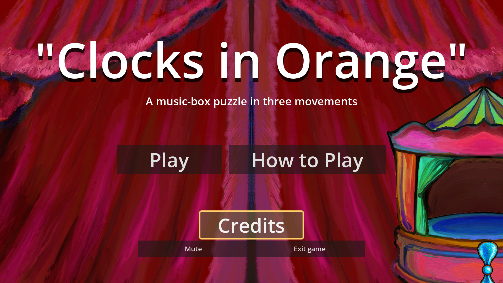
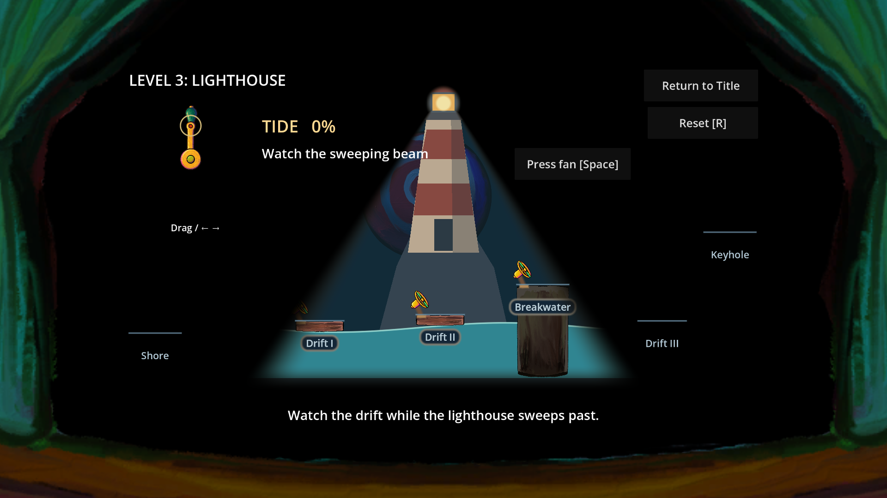

# Main into polish integration review

The integration branch merges main `e196704` into polish `294f22b`, preserving
both parents for the PR targeting `polish`.

The ocean shared base, timed landing rules, drifting decks, lighthouse sweep,
scene geometry and artwork are unchanged from `polish`. Main contributes the
release session/audio, menus, credits, Level 1 pause/retry fixes and export tools.
Integration changes adapt night markers, player instructions, release tests,
playthrough timing and the export dependency list to the redesigned stages.

Validation used Godot 4.7.2-stable with GL Compatibility. All 12 source
regressions passed, including Level 1 47/47, day ocean 147/147, lighthouse 23/23,
and release behavior 57/57. Real-time, fixed-step and rendered scripted
playthroughs solved the campaign, retried both missed landings, replayed and
returned to title. Rendered release checks passed at 1920x1080 and 1280x720.
The rendered lighthouse passed 29 checks, including darkness and a visible
landing edge outside the beam.

The Windows PCK was checked from an isolated directory, without source-resource
fallback: 57 release checks and the full real-input playthrough passed. Native
extracted-EXE headless startup passed. Human playtesting, listening, real
fullscreen switching, and upload/download acceptance remain separate checks.

The source build logs are under `.godot/release-logs`; supplemental integration
logs and route captures are under `.godot/integration-qa` (both ignored).
Some harness shutdowns report the existing MP3 resource warning; the sandbox
also reports a root-certificate-store warning. Neither is a gameplay assertion.

The following captures are actual 1920x1080 renders of the combined source.
The `.gdignore` in this folder excludes review evidence from Godot imports.

